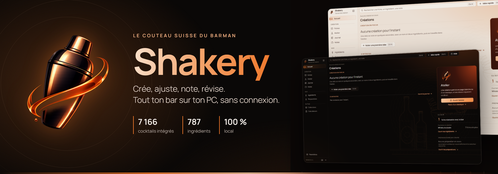

<p align="center">
  
</p>

# Shakery

Le carnet de création du barman, installé sur son PC. Tout est local et hors ligne : pas de compte, pas de serveur, pas de télémétrie.

## Ce que fait Shakery

|                                |                                                                                                                                         |
| ------------------------------ | --------------------------------------------------------------------------------------------------------------------------------------- |
| **7 166 cocktails intégrés**   | Les classiques sont dans l'application. Ctrl K, quelques lettres, Entrée : la fiche s'ouvre, même avec une faute de frappe.             |
| **Atelier**                    | Change une dose et vois degré, sucre, acidité et volume bouger. Versions, variantes et comparaison.                                     |
| **Journal et carnet**          | Note chaque essai, la prochaine étape à tester, et les idées qui ne sont pas encore des fiches.                                         |
| **Mon bar**                    | Tes bouteilles, ce que tu peux faire ce soir, les achats qui débloquent le plus de fiches. Code-barres facultatif avec Open Food Facts. |
| **Préparations**               | Sirops, cordiaux, fabrications en cours et dates limites.                                                                               |
| **Collections et révision**    | Une carte ou un concours, en PDF, avec ses quiz et ses cartes mémoire.                                                                  |
| **Fiche technique imprimable** | A4 ou A5, en PDF ou sur papier, avec Ctrl P.                                                                                            |
| **Partage**                    | Markdown, image, CSV, et fichier `.shakery` pour un collègue ou un autre PC.                                                            |
| **Deux thèmes**                | Sombre ou clair chaud, jusque dans la barre de titre.                                                                                   |
| **Étiquettes et batch**        | Étiquettes de bouteille sur rouleau ou planche, feuille de batch avec ce qui se garde et ce qui s'ajoute au service.                    |
| **Photos et mise en forme**    | Une photo par fiche ou dégustation, du gras, de l'italique et des listes dans les textes.                                               |
| **Aide sur chaque écran**      | Le bouton Aide, ou F1, explique chaque champ, bouton, calcul et raccourci de l'écran affiché.                                           |
| **Mode préparation**           | La fiche en plein écran, lisible à un mètre, avec F11.                                                                                  |

L'aide est dans l'application : bouton **Aide** en haut de chaque écran, ou F1. Le guide complet est en bas de la barre latérale, ou dans Paramètres.

## Installer

L'installeur Windows se construit avec `npm run dist:win` : `dist/Shakery-<version>-setup.exe`. Il s'installe pour l'utilisateur courant, sans droits administrateur. Il n'est pas signé : Windows SmartScreen affiche un avertissement au premier lancement.

Les DMG macOS (arm64 et x64) se construiraient avec `npm run dist:mac`, sur un Mac uniquement, ni signés ni notarisés. Ils ne sont pas construits pour l'instant.

Au premier lancement, le chargement des classiques prend quelques secondes, une seule fois.

## Développer

Il faut Node.js 22.12 ou plus récent (testé avec Node 24).

```bash
npm install
```

```bash
npm run dev
```

Si le binaire Electron manque (« Electron failed to install correctly ») :

```bash
node node_modules/electron/install.js
```

| Commande              | Rôle                                                                                                            |
| --------------------- | --------------------------------------------------------------------------------------------------------------- |
| `npm run check`       | Types, lint, format et tests unitaires, comme la CI.                                                            |
| `npm run test:e2e`    | Construit l'application puis lance les tests Playwright sur Electron.                                           |
| `npm run screens`     | Capture chaque écran dans les deux thèmes et trois tailles, avec un rapport des débordements et des contrastes. |
| `npm run perf`        | Mesure chargement, recherche, ouverture et calcul sur un gros carnet.                                           |
| `npm run licenses`    | Met à jour les licences affichées dans « À propos ».                                                            |
| `npm run maf:convert` | Convertit les carnets MAF de `imports/maf/` (données personnelles, hors de git).                                |
| `npm run dist:win`    | Construit l'installeur Windows.                                                                                 |
| `npm run dist:mac`    | Construit les DMG macOS.                                                                                        |

## Architecture en bref

- `src/main/` : processus principal. Fenêtre, sécurité, base SQLite, sauvegardes, export, impression.
- `src/preload/` : expose `window.shakery`, une liste fermée de fonctions issue du contrat IPC.
- `src/shared/` : contrat IPC et schémas, partagés par tous les processus.
- `src/core/` : logique métier pure, sans Electron, Node ni DOM.
- `src/renderer/` : interface React. Les textes français sont dans `src/renderer/src/i18n/fr/`.

Documentation : [cahier des charges](docs/SPEC.md), [architecture](docs/ARCHITECTURE.md), [sécurité](docs/SECURITY.md), [décisions](docs/DECISIONS.md), [sources des données](docs/DATA_SOURCES.md).

## Données et confidentialité

Le carnet est un fichier SQLite dans le dossier de données de l'application, sauvegardé chaque jour. Une seule fonction utilise Internet, la recherche d'une bouteille par code-barres, et elle se coupe dans les paramètres.

Les formules des classiques viennent de l'IBA et de 24cocktails.com. Ces dernières sont réservées à un usage personnel : ce dépôt doit rester privé tant qu'il contient `resources/seed/recipes-24c.json`.
