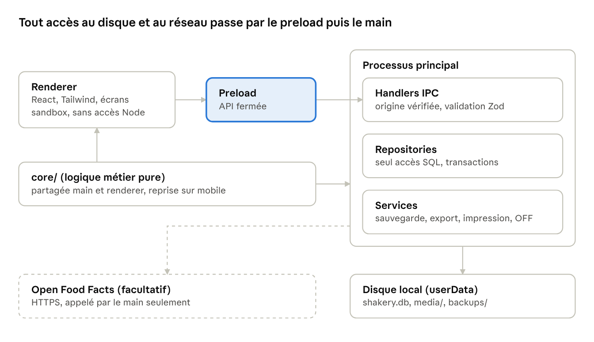

# Prompt de développement – Shakery

16 novembre 2026

Fichiers joints à ce cahier des charges : maquettes de l'accueil et kit de composants dans `design/maquettes/` (captures PNG, HTML autonome, sources du canevas), logo dans `design/assets/logo/`, tokens de la section 11 dans `design/tokens.css`, référence visuelle dans `design/reference/`.

## 1. Mode d'emploi et règles de travail

Ce document est le cahier des charges complet de **Shakery**, une application de bureau pour barmans. Il est destiné à un agent de développement (Claude Code ou équivalent), qui doit le lire en entier avant d'écrire la moindre ligne de code.

1. Développe phase par phase, dans l'ordre de la section 14. À la fin de chaque phase, arrête-toi, résume ce qui a été livré, liste les écarts avec cette spec et attends une validation explicite avant de continuer.
2. Avant la phase 0, reformule en dix lignes maximum ta compréhension du projet et pose uniquement les questions bloquantes. Ne pose aucune question dont la réponse figure dans ce document.
3. Consigne toute décision non couverte par la spec dans `docs/DECISIONS.md` (date, contexte, choix, alternatives écartées). Une décision qui touche au modèle de données, à l'architecture ou à la sécurité exige une validation préalable.
4. Code, identifiants, schéma de base et messages de commit en anglais. Interface, contenus et documentation utilisateur en français.
5. TypeScript en mode strict partout, aucun `any` non justifié. Chaque fonction de calcul métier est couverte par des tests avant d'être branchée à l'interface.
6. N'ajoute aucune dépendance sans la justifier dans `DECISIONS.md` (rôle, poids, activité du projet, licence). Utilise l'API native d'Electron, de Node ou du navigateur quand elle suffit.
7. Installe les dernières versions stables et vérifie leur documentation officielle plutôt que ta mémoire, en particulier pour Electron, electron-vite, Tailwind CSS et Drizzle, dont les API évoluent vite.
8. Un commit par unité logique, au format Conventional Commits. À chaque commit, le projet compile et passe le lint et les tests.
9. N'invente aucune donnée présentée comme fiable. Durées de conservation, taux de dilution, équivalences d'unités, teneurs en sucre et en acide sont des valeurs par défaut modifiables, signalées comme telles dans l'interface et sourcées dans `docs/DATA_SOURCES.md`.

## 2. Contexte et objectif

Shakery est le carnet de création personnel d'un barman, installé sur son propre PC. Il y conserve ses fiches, fait évoluer ses recettes de l'idée à la version finale, note chaque essai, simule l'équilibre d'un mélange avant de le réaliser et révise les cartes qu'il doit connaître. Il remplace le carnet papier, les notes de téléphone éparpillées et les captures d'écran.

L'utilisateur est unique : un barman, professionnel ou passionné, qui travaille ses créations chez lui. Il n'y a ni équipe, ni compte, ni poste partagé. Les usages, par ordre d'importance :

1. Créer et faire évoluer une recette, de l'idée au brouillon, aux essais puis à la version finale, avec historique et comparaison des versions.
2. Noter ses dégustations : ce qui fonctionne, ce qui manque, l'ajustement à tester ensuite.
3. Simuler un mélange : volume, degré, sucre, acidité et dilution recalculés pendant qu'il change les doses.
4. Retrouver instantanément n'importe quelle fiche, une création ou un classique.
5. Gérer son bar personnel : bouteilles possédées, préparations maison en cours et leur date limite, cocktails réalisables avec ce qu'il a.
6. Réviser les fiches d'une carte (celle du bar où il travaille, un concours, un thème).

Shakery sert aussi de référence au quotidien, un « couteau suisse du barman » : environ 7 000 recettes de cocktails (export de 24cocktails.com) sont intégrées à la base de départ comme classiques, consultables hors ligne. Taper « Boulevardier » ouvre la fiche complète. Usage strictement personnel (D-036).

Objectifs mesurables de la version 1 :

- Noter une idée de cocktail en moins de 15 secondes depuis n'importe quel écran (Ctrl+N, un nom, deux ingrédients, Entrée).
- Ouvrir n'importe quelle fiche en moins de 3 secondes (Ctrl+K, trois lettres, Entrée).
- Voir l'effet d'un changement de dose sur le degré, le sucre et l'acidité en moins de 100 ms.
- Démarrer en moins de 3 secondes sur un PC d'entrée de gamme (4 Go de RAM) et fonctionner sans connexion Internet.

Shakery est un outil personnel. Les fonctions propres à un établissement (équipe, traçabilité sanitaire, mise en place, gestion de carte avec TVA) sont hors cible.

## 3. Contraintes non négociables

Ces règles priment sur toute autre considération. Si une fonctionnalité ne peut pas les respecter, elle est reportée, pas adaptée.

- **Tout est local.** Les données vivent dans un fichier SQLite du dossier `userData` de l'application. Aucun serveur, aucun compte, aucune base distante.
- **Hors ligne à 100 %.** La seule fonction réseau autorisée est la recherche facultative d'un produit par code-barres sur Open Food Facts (section 9). Elle est désactivable, et l'application reste entièrement utilisable sans elle.
- **Aucune télémétrie,** aucun traceur, aucun CDN. Polices, icônes et images sont embarquées dans l'application.
- **Gratuit,** sans publicité ni fonction payante.
- **Le carnet appartient à l'utilisateur.** Export complet dans un format ouvert et lisible (JSON dans une archive ZIP) à tout moment, sans perte, photos comprises.
- **Plateformes.** Cible principale Windows 10 et 11 en 64 bits, cible secondaire macOS. Linux est possible mais pas prioritaire.
- **Ergonomie de PC personnel.** Clavier et souris d'abord, et tout est faisable au clavier. Fenêtre minimale de 1100 × 700 px. Le mode préparation reste lisible à un mètre, pour suivre une fiche pendant qu'on réalise le cocktail.
- **Français.** Tous les textes de l'interface sont centralisés dans un fichier de chaînes pour permettre une traduction ultérieure.
- **Préparer le téléphone sans le développer.** La consultation sur téléphone est la première évolution prévue après la version 1 (section 15). Logique métier isolée et réutilisable, identifiants UUIDv7, horodatages et suppression logique sur toutes les tables, format d'export `.shakery` stable et versionné.

## 4. Stack et outillage

La stack est imposée : React, Electron et Tailwind CSS, en TypeScript. Les outils ci-dessous la complètent. Toute substitution passe par `DECISIONS.md` et une validation.

| Rôle | Choix | Précision |
| --- | --- | --- |
| Langage | TypeScript strict | main, preload, renderer, scripts |
| Coquille desktop | Electron | réglages de sécurité de la section 6 |
| Build et dev | electron-vite | séparation main / preload / renderer, rechargement à chaud |
| Packaging | electron-builder | NSIS sous Windows, DMG sous macOS |
| Interface | React | composants fonctionnels et hooks |
| Styles | Tailwind CSS v4 | thème défini en variables CSS (section 11) |
| Primitives UI | Radix UI via shadcn/ui | composants copiés dans le projet puis restylés |
| Palette de commandes | cmdk | raccourci global Ctrl+K |
| Icônes | lucide-react | embarquées |
| Animations | Motion | respect de `prefers-reduced-motion` |
| Routage | React Router, routeur par hash | compatible avec le chargement en `file://` |
| Données côté interface | TanStack Query | cache et invalidation des appels IPC |
| État d'interface | Zustand | uniquement pour l'état UI léger |
| Formulaires | React Hook Form + Zod | schémas Zod partagés avec le main |
| Listes longues | TanStack Virtual | milliers d'entrées sans ralentissement |
| Base de données | SQLite via better-sqlite3 | accès exclusif depuis le main |
| Schéma et migrations | Drizzle ORM + drizzle-kit | migrations versionnées, exécutées au démarrage |
| Identifiants | UUIDv7 | triables, sûrs pour une future synchronisation |
| Dates | date-fns | locale française |
| Archives | yazl / yauzl | export et import des sauvegardes |
| Journaux | electron-log | fichier local avec rotation |
| Tests | Vitest, Testing Library, Playwright | Playwright pilote Electron pour les tests de bout en bout |
| Qualité | ESLint, typescript-eslint, Prettier | bloquants en CI |

better-sqlite3 est un module natif. Il doit être recompilé pour la version d'Electron (`electron-builder install-app-deps` en `postinstall`). Le binaire recompilé ne se charge plus sous Node pur, donc les tests qui touchent la base échoueront sous Vitest classique. Lance ces tests via Electron en mode Node (`ELECTRON_RUN_AS_NODE=1`) ou maintiens une compilation dédiée aux tests, et documente la solution retenue dès la phase 1.

## 5. Architecture du projet

Le renderer n'accède jamais au système. Toute lecture ou écriture passe par une API typée et fermée, exécutée et validée dans le processus principal. La logique métier vit dans `core/`, sans dépendance à Electron ni au DOM, pour être reprise telle quelle sur mobile.

```
shakery/
├─ electron.vite.config.ts
├─ electron-builder.yml
├─ drizzle.config.ts
├─ src/
│  ├─ main/                  processus principal
│  │  ├─ index.ts            fenêtre, cycle de vie, verrou d'instance unique
│  │  ├─ security.ts         CSP, navigation, permissions
│  │  ├─ protocol.ts         protocole shakery-media:// pour les images locales
│  │  ├─ ipc/                un fichier par domaine, validation Zod de chaque appel
│  │  ├─ db/                 connexion, migrations, repositories
│  │  ├─ services/           sauvegarde, export/import, impression, Open Food Facts
│  │  └─ seed/               chargement et mise à jour des données de départ
│  ├─ preload/
│  │  └─ index.ts            expose window.shakery via contextBridge
│  ├─ shared/                contrat IPC, schémas Zod, types partagés
│  ├─ core/                  logique métier pure (aucun import Electron, Node ou DOM)
│  │  ├─ units.ts
│  │  ├─ abv.ts
│  │  ├─ dilution.ts
│  │  ├─ balance.ts          sucre, acidité, rapport, zones de référence
│  │  ├─ compare.ts          diff entre versions ou recettes
│  │  ├─ batch.ts
│  │  ├─ cost.ts
│  │  ├─ allergens.ts
│  │  ├─ shelf-life.ts
│  │  ├─ availability.ts     réalisable avec mon bar, il manque un ingrédient
│  │  ├─ normalize.ts
│  │  ├─ fuzzy.ts
│  │  └─ practice.ts         génération des questions de révision
│  └─ renderer/
│     ├─ index.html
│     └─ src/
│        ├─ app/              routes, layout, providers
│        ├─ features/         home, recipes, lab, journal, notebook, my-bar,
│        │                    preps, collections, practice, calculators, settings
│        ├─ components/       composants partagés (verre, formulaires, palette, jauges)
│        ├─ print/            gabarits d'impression
│        ├─ styles/           tokens, thème, polices
│        ├─ i18n/             chaînes françaises
│        └─ lib/              client IPC typé, hooks
├─ resources/                icônes, polices, base de départ
├─ scripts/seed/             génération des données de départ (jamais exécuté par l'app)
├─ data/seed/                JSON curés, versionnés, relus à la main
├─ tests/e2e/                scénarios Playwright
└─ docs/                     DECISIONS.md, DATA_SOURCES.md, ARCHITECTURE.md, SECURITY.md
```

Principes à respecter :

- **Contrat IPC unique.** Chaque opération est déclarée une seule fois dans `shared/` : nom (`recipes.list`, `tastingNotes.create`…), schéma Zod d'entrée, type de sortie. Le main valide avec ce schéma, le preload et le client du renderer en dérivent leurs types. Aucun canal n'existe hors de ce contrat.
- **Repositories.** Seuls les repositories du main exécutent du SQL. Ils implémentent des interfaces (`RecipeRepository`, `TastingNoteRepository`…) définies dans `shared/`, pour qu'une version mobile puisse fournir une autre implémentation.
- **Transactions.** Toute opération qui écrit dans plusieurs tables (enregistrement d'une fiche avec ses lignes, fusion d'ingrédients, import) s'exécute dans une transaction.
- **Erreurs typées.** Le main renvoie `{ ok: false, code, message }`, jamais une stack trace. Le renderer traduit le code en message compréhensible.
- **Instance unique.** Une seule instance de Shakery peut tourner à la fois (`requestSingleInstanceLock`), pour éviter deux processus sur la même base.
- **Pas de logique métier dans les composants.** Les composants appellent `core/` ou l'API, ils ne recalculent rien eux-mêmes.



Le renderer appelle `window.shakery`, le preload transmet, le main valide puis lit ou écrit. `core/` est importé des deux côtés et ne dépend de rien. Le lien pointillé vers Open Food Facts n'existe que si le réglage est activé.

## 6. Sécurité Electron

Shakery importe des fichiers, affiche des images et du texte libre et peut appeler une API externe. Le durcissement est donc mis en place en phase 0 et vérifié par des tests automatisés. Chaque mesure est documentée dans `docs/SECURITY.md`.

**Fenêtres et processus**

- `contextIsolation: true`, `sandbox: true`, `nodeIntegration: false`, `webSecurity: true`, `webviewTag: false`.
- `setWindowOpenHandler` refuse toute nouvelle fenêtre. `will-navigate` et `will-redirect` bloquent toute navigation hors de l'application.
- Les liens externes (attributions, licences) passent par `shell.openExternal` après validation : schéma `https` uniquement, domaine présent dans une liste blanche codée en dur.
- `session.setPermissionRequestHandler` et `setPermissionCheckHandler` refusent tout par défaut (caméra, micro, notifications, géolocalisation, presse-papiers en lecture).
- DevTools désactivés en production.
- Electron Fuses au packaging : `RunAsNode` désactivé, `EnableNodeOptionsEnvironmentVariable` désactivé, `EnableNodeCliInspectArguments` désactivé, `OnlyLoadAppFromAsar` activé, `EnableEmbeddedAsarIntegrityValidation` activé.

**IPC**

- Le preload n'expose jamais `ipcRenderer` ni aucun module Node. Il expose une liste fermée de fonctions métier sous `window.shakery`.
- Chaque handler vérifie l'origine de l'appel (`event.senderFrame`) puis valide les arguments avec Zod avant de toucher à la base ou au disque. Les schémas fixent une longueur maximale à chaque chaîne et une taille maximale à chaque tableau.

**Contenu affiché**

- CSP stricte appliquée par en-tête de réponse : `default-src 'self'; script-src 'self'; style-src 'self'; img-src 'self' data: shakery-media:; font-src 'self'; connect-src 'self'; object-src 'none'; base-uri 'none'; form-action 'none'; frame-ancestors 'none'`. N'ajoute `'unsafe-inline'` à `style-src` que si une dépendance l'exige, et documente laquelle.
- Le renderer n'a besoin d'aucun `connect-src` externe, puisque l'appel à Open Food Facts est fait par le main.
- Aucun `dangerouslySetInnerHTML`. Les textes libres (étapes, notes) sont rendus comme du texte, avec au plus gras, italique et listes interprétés par un parseur qui ne produit jamais de HTML brut.

**Fichiers et chemins**

- Les images sont servies par le protocole `shakery-media://` (`protocol.handle`), limité au dossier médias. Le chemin est normalisé et toute traversée est refusée (`..`, chemin absolu, lien symbolique sortant du dossier).
- Import d'image : 10 Mo maximum, type réel vérifié par signature (magic bytes), redimensionnement à 1600 px maximum et réencodage en WebP via canvas dans le renderer, ce qui supprime aussi les métadonnées EXIF. Le main revérifie la signature WebP et la taille avant d'écrire.
- Import de sauvegarde : chaque entrée de l'archive doit rester sous le dossier cible (protection zip slip), limites de taille décompressée et de nombre d'entrées (protection zip bomb), validation Zod complète du JSON avant toute écriture, import dans une transaction annulée au moindre échec.

**Base de données**

- Requêtes exclusivement paramétrées (Drizzle). Aucune concaténation de SQL.
- La saisie de recherche n'est jamais injectée brute dans `MATCH`. Elle est normalisée, découpée en termes, et chaque terme est échappé et placé entre guillemets, ce qui neutralise la syntaxe FTS5 (`OR`, `NOT`, `NEAR`, `*`, `^`, guillemets).
- `PRAGMA foreign_keys = ON`, `journal_mode = WAL`, `busy_timeout` défini.

**Réseau**

- Seul le service Open Food Facts du main émet des requêtes : hôte codé en dur, HTTPS uniquement, `User-Agent` qui identifie Shakery et sa version, timeout de 8 secondes, taille de réponse plafonnée, limiteur de débit côté client. Les réponses sont validées par Zod comme toute entrée externe.
- Réglage désactivé = aucune requête sortante. Un test le vérifie.

**Dépendances**

- Versions verrouillées, `npm audit` en CI, revue de licence et d'activité pour chaque nouvelle dépendance.

## 7. Modèle de données

Le modèle sépare l'ingrédient générique, que les recettes utilisent (« gin London Dry »), de la bouteille de marque que le barman possède. Une préparation maison est à la fois une recette et un ingrédient. Chaque recette a un statut de création et un historique de versions, auquel se rattachent les notes de dégustation.

```
-- Colonnes communes à toutes les tables métier
id TEXT PRIMARY KEY            -- UUIDv7
created_at INTEGER             -- epoch ms UTC
updated_at INTEGER
deleted_at INTEGER NULL        -- suppression logique

categories
  name, slug, parent_id -> categories NULL, sort_order
  batch_hint ('ok' | 'add_at_service' | 'fresh')   -- gazeux, œuf, jus frais…
  seed_key TEXT NULL UNIQUE

ingredients                    -- ingrédient générique
  name, name_normalized, category_id -> categories
  default_abv REAL NULL         -- % vol
  sugar_g_per_l REAL NULL
  acid_g_per_l REAL NULL        -- acidité totale exprimée en acides organiques
  composition_source ('ciqual' | 'computed' | 'label' | 'user') NULL
  composition_confidence ('sourced' | 'estimated') NULL
  flavor_tags TEXT              -- JSON : profil aromatique libre (agrume, herbacé, fumé…)
  description TEXT NULL
  allergens TEXT                -- JSON : codes de la liste des 14
  prep_recipe_id -> recipes NULL  -- renseigné si c'est une préparation maison
  is_staple INTEGER             -- toujours disponible (eau, sucre, glace)
  is_favorite INTEGER
  source ('seed' | 'wikidata' | 'user'), external_ref TEXT NULL  -- QID Wikidata
  seed_key TEXT NULL UNIQUE

ingredient_aliases
  ingredient_id -> ingredients, alias, alias_normalized

products                       -- bouteille de marque
  ingredient_id -> ingredients, brand, name
  abv REAL NULL, volume_ml INTEGER NULL
  sugar_g_per_l REAL NULL, acid_g_per_l REAL NULL   -- priment sur l'ingrédient
  barcode TEXT NULL UNIQUE
  purchase_price_cents INTEGER NULL   -- prix payé
  owned INTEGER                 -- je l'ai chez moi
  personal_notes TEXT NULL      -- avis sur le produit
  allergens TEXT                -- JSON
  image_path TEXT NULL
  source ('user' | 'off')

off_cache                      -- réponses Open Food Facts, séparées (licence ODbL)
  barcode PRIMARY KEY, payload TEXT (JSON validé), fetched_at INTEGER

glasses                        name, capacity_ml NULL, sort_order, seed_key
ice_types                      name, sort_order, seed_key

recipes
  name, name_normalized
  kind ('cocktail' | 'prep')
  status ('idea' | 'draft' | 'testing' | 'final' | 'archived')
  origin ('mine' | 'classic' | 'other'), credit TEXT NULL   -- créateur, bar, source
  family ('sour' | 'spirit_forward' | 'highball' | 'fizz' | 'flip' | 'tiki'
          | 'punch' | 'shot' | 'non_alcoholic' | 'other') NULL
  method ('shake' | 'dry_shake' | 'stir' | 'build' | 'throw' | 'blend' | 'swizzle' | 'other')
  glass_id -> glasses NULL, ice_id -> ice_types NULL
  garnish TEXT NULL
  steps TEXT                    -- JSON : string[]
  notes TEXT NULL, photo_path TEXT NULL
  tags TEXT                     -- JSON : string[]
  dilution_override_pct REAL NULL
  parent_recipe_id -> recipes NULL  -- variante dérivée d'une autre fiche
  -- champs propres aux préparations
  yield_ml INTEGER NULL
  shelf_life_days INTEGER NULL  -- fixé par l'utilisateur, jamais inventé
  storage_notes TEXT NULL
  is_favorite INTEGER, version INTEGER
  source ('seed_iba' | 'seed' | 'user'), seed_key TEXT NULL UNIQUE

recipe_lines
  recipe_id -> recipes, ingredient_id -> ingredients
  preferred_product_id -> products NULL
  quantity REAL NULL
  unit ('ml' | 'cl' | 'oz' | 'dash' | 'drop' | 'barspoon' | 'tsp' | 'g'
        | 'piece' | 'leaf' | 'slice' | 'wedge' | 'top' | 'to_taste')
  top_estimate_ml REAL NULL
  is_optional INTEGER, is_garnish INTEGER, sort_order, note TEXT NULL

recipe_history                 -- instantané complet à chaque nouvelle version
  recipe_id -> recipes, version, snapshot TEXT (JSON), label TEXT NULL

tasting_notes                  -- journal de dégustation
  recipe_id -> recipes, recipe_version INTEGER
  tasted_at INTEGER
  overall INTEGER NULL          -- 1 à 5
  scores TEXT                   -- JSON : balance, sweetness, acidity, bitterness,
                                --        strength, dilution, texture, aroma ; -2 à +2, 0 = juste
  comment TEXT NULL
  next_step TEXT NULL           -- ajustement à tester
  next_step_done INTEGER
  context TEXT NULL, photo_path TEXT NULL

notebook_entries               -- carnet libre : idées, associations, techniques
  title, body TEXT, tags TEXT (JSON), is_pinned INTEGER
notebook_links
  entry_id -> notebook_entries, entity_type ('recipe' | 'ingredient' | 'product'), entity_id

prep_batches                   -- une fabrication de préparation maison
  recipe_id -> recipes          -- kind = 'prep'
  made_at INTEGER, quantity_ml INTEGER NULL
  best_before INTEGER NULL      -- calculée ou saisie
  status ('active' | 'finished' | 'discarded'), notes TEXT NULL

collections                    -- carte d'un bar, concours, thème
  name, description TEXT NULL, kind ('menu' | 'competition' | 'theme' | 'other'), sort_order
collection_items
  collection_id -> collections, recipe_id -> recipes, sort_order, note TEXT NULL
  sale_price_cents INTEGER NULL

practice_sessions              collection_id -> collections NULL, score, total, mistakes TEXT (JSON), finished_at
recent_views                   entity_type, entity_id, viewed_at
settings                       key PRIMARY KEY, value TEXT (JSON)
search_index                   table virtuelle FTS5 (section 12)
```

Règles du modèle :

- **Quantités.** Stockées telles que saisies (`quantity` + `unit`) pour respecter la fiche d'origine. La conversion en millilitres est faite à la volée par `core/units.ts`.
- **Composition.** Sucre et acidité en grammes par litre, avec leur source et leur niveau de confiance. Une valeur absente reste `NULL`, jamais zéro. La composition d'une préparation maison est calculée depuis sa recette et n'est pas saisie.
- **Versions.** Un enregistrement depuis l'atelier ou l'éditeur crée une nouvelle version et un instantané dans `recipe_history`. Une simple correction de faute peut être enregistrée sans nouvelle version (case à cocher). Chaque note de dégustation pointe vers la version goûtée.
- **Statuts.** `idea` exige seulement un nom. Les calculs ne sont exigés complets qu'à partir de `final`, et l'interface signale ce qui manque.
- **Montants** en centimes entiers, jamais en flottants. Pas de TVA : c'est un carnet personnel.
- **Dates** en epoch ms UTC.
- **Normalisation.** `name_normalized` et `alias_normalized` : minuscules, accents retirés (NFD puis suppression des diacritiques), ligatures décomposées (« œ » devient « oe »), espaces réduits. Unicité de (`name_normalized`, `category_id`) sur les ingrédients non supprimés.
- **Intégrité.** Un ingrédient utilisé dans une recette ne peut pas être supprimé, seulement fusionné avec un autre. Une préparation ne peut pas s'utiliser elle-même, directement ou par chaîne : contrôle à l'enregistrement.
- **Suppression logique** partout. La purge définitive se fait seulement via la corbeille, par action explicite.
- **Index** sur toutes les clés étrangères, sur `recipes(status, updated_at)`, `tasting_notes(recipe_id, tasted_at)`, `prep_batches(status, best_before)` et `recent_views(viewed_at)`.
- **Migrations** générées par drizzle-kit, versionnées, exécutées au démarrage après une sauvegarde automatique. Une migration ne supprime jamais de données utilisateur sans étape de conversion.

## 8. Logique métier (`core/`)

Tous les calculs sont des fonctions pures de `core/`, testées avant d'être branchées à l'interface. Quand une donnée manque, le résultat est marqué incomplet et l'élément fautif est nommé. Une valeur manquante n'est jamais remplacée par zéro en silence.

**Unités.** Conversion en ml : `cl` = 10, `oz` = valeur paramétrable (30 ml en arrondi de bar ou 29,57 ml exact). `dash`, `drop`, `barspoon` et `tsp` ont des équivalences par défaut modifiables et affichées comme approximations. `g`, `piece`, `leaf`, `slice`, `wedge` et `to_taste` ne sont pas volumétriques et sont exclus des calculs. `top` compte pour `top_estimate_ml` s'il est renseigné, sinon il rend le résultat incomplet. L'unité d'affichage (ml, cl ou oz) est un réglage, avec arrondi lisible (0,5 cl, 1/4 oz).

**Degré estimé.** Pour chaque ligne volumétrique non optionnelle, le degré utilisé est celui du produit préféré, sinon celui de l'ingrédient, sinon celui calculé de la préparation. Avec vᵢ le volume en ml, aᵢ le degré en % et d le taux de dilution de la méthode :

```latex
V_0 = \sum_i v_i \qquad A = \sum_i \frac{v_i \, a_i}{100} \qquad V_f = V_0 \,(1 + d) \qquad \text{ABV}_f = \frac{A}{V_f} \times 100
```

Le degré d'une préparation se calcule de la même façon, sans dilution, en divisant par `yield_ml` s'il est renseigné. Le calcul est récursif à travers les préparations imbriquées.

**Dilution.** Chaque méthode a un taux par défaut, modifiable dans les paramètres et surchargeable par fiche. Les valeurs initiales sont proposées par l'agent avec leur source dans `DATA_SOURCES.md`, puis validées par l'utilisateur en fin de phase 3. L'interface présente toujours le degré final comme une estimation.

**Équilibre sucre et acidité.** Pour chaque ligne volumétrique, la teneur en sucre sᵢ et en acide cᵢ (g/L) vient du produit préféré, sinon de l'ingrédient, sinon du calcul de la préparation. S et C sont les masses en grammes, les concentrations finales sont en g pour 100 ml de boisson servie, R est le rapport sucre / acide :

```latex
S = \sum_i \frac{v_i \, s_i}{1000} \qquad C = \sum_i \frac{v_i \, c_i}{1000} \qquad \text{sucre}_f = \frac{S}{V_f} \times 100 \qquad \text{acide}_f = \frac{C}{V_f} \times 100 \qquad R = \frac{S}{C}
```

Une ligne sans donnée rend le résultat incomplet et elle est nommée. Une ligne dont la donnée est `estimated` rend le résultat « estimé ».

**Zones de référence.** Aucune norme n'est codée en dur. Pour chaque famille (`sour`, `spirit_forward`…), Shakery calcule l'intervalle entre le 25e et le 75e centile du degré, du sucre, de l'acidité et du rapport, à partir des fiches `final` et des classiques dont les données sont complètes. La zone n'est affichée qu'à partir de 5 fiches, et une infobulle liste les fiches qui la composent. Le calcul est mis en cache et recalculé quand une fiche concernée change.

**Atelier.** Il travaille sur une copie en mémoire de la recette. Les doses varient par pas paramétrable (2,5 ml ou 1/4 oz par défaut), une ligne peut être désactivée sans être supprimée, annuler et rétablir sont illimités pendant la session. Tous les indicateurs sont recalculés en moins de 100 ms. Rien n'est écrit en base avant « Enregistrer comme nouvelle version » ou « Enregistrer comme variante » (nouvelle fiche avec `parent_recipe_id`). Quitter avec des modifications demande confirmation.

**Comparaison.** `compare.ts` produit le diff de deux instantanés (lignes ajoutées, retirées, doses modifiées avec l'écart, méthode ou verre changés) et l'écart de chaque indicateur. Jusqu'à trois versions ou recettes côte à côte.

**Batch.** Entrées : une fiche, une cible (N verres ou un volume en ml), l'option « ajouter l'eau de dilution » pour les cocktails pré-mélangés ou mis en bouteille, un pas d'arrondi. Chaque ligne est multipliée puis arrondie, les unités à la pièce à l'unité supérieure, la décoration est exclue par défaut. L'eau ajoutée vaut V₀ × d × N. Les lignes dont la catégorie porte `batch_hint = 'add_at_service'` ou `'fresh'` sont sorties du batch et listées à part avec un avertissement.

**Coût de revient (facultatif).** Coût au ml = prix payé divisé par la contenance du produit préféré, à défaut la médiane des bouteilles possédées de l'ingrédient. Une préparation a un coût au ml égal au coût de ses lignes divisé par son rendement. La fiche affiche le coût par verre. Dans une collection de type `menu` avec prix de vente, Shakery affiche aussi le rapport prix / coût. Pas de TVA.

**Allergènes.** Liste réglementaire des 14 : céréales contenant du gluten, crustacés, œufs, poissons, arachides, soja, lait, fruits à coque, céleri, moutarde, graines de sésame, anhydride sulfureux et sulfites, lupin, mollusques. Les allergènes d'une fiche sont l'union de ceux de ses lignes, de façon récursive à travers les préparations, ceux des lignes optionnelles étant affichés à part. L'affichage rappelle que l'information dépend des données saisies.

**Préparations maison.** `best_before` = fin de journée locale de `made_at` + `shelf_life_days`. Sans durée définie, l'utilisateur saisit une date ou n'en met pas : la fabrication est alors signalée « sans date limite » et ne déclenche aucune alerte. Aucune durée de conservation n'est jamais proposée par l'application. États : `ok`, `expiring` (seuil réglable, 1 jour par défaut), `expired`. Une fabrication expirée reste visible jusqu'à son passage en « terminée » ou « jetée ». Tests obligatoires autour de minuit et des changements d'heure.

**Disponibilité.** Un ingrédient est disponible si une bouteille `owned` existe, s'il est `is_staple`, ou, pour une préparation, si une fabrication `active` non expirée existe. Une fiche est réalisable si toutes ses lignes non optionnelles et hors décoration sont disponibles. Les fiches auxquelles il manque exactement un ingrédient sont regroupées par ingrédient manquant, ce qui donne une liste d'achats utile (« un vermouth rouge débloque 7 fiches »).

**Révision.** Génération de questions à choix multiples à partir d'une collection : dose d'un ingrédient, méthode, verre, glace, décoration, ingrédient intrus. Les mauvaises réponses viennent des autres fiches de la collection. Aucune question n'est générée si la donnée source est vide.

**Recherche approchée.** `normalize.ts` produit la forme normalisée (règles de la section 7). `fuzzy.ts` implémente une distance de Damerau-Levenshtein bornée, utilisée en repli quand la recherche plein texte ne renvoie rien.

## 9. Données de départ et sources externes

Shakery est livré avec une base de départ générée au moment du build, jamais pendant l'exécution. Les sources externes servent à construire cette base. L'application installée ne les interroge pas, à l'exception de la recherche facultative par code-barres.

**Pipeline (`scripts/seed/`)**

1. Récupération des sources, avec mise en cache locale des réponses dans `scripts/seed/.cache/` pour rejouer sans réseau.
2. Normalisation (section 7), dédoublonnage sur `name_normalized` et sur les alias, rattachement à l'arbre de catégories, rapprochement avec la table Ciqual pour la composition.
3. Écriture de JSON lisibles dans `data/seed/` (`categories.json`, `ingredients.json`, `glasses.json`, `ice.json`, `recipes.json`, `preps.json`), chaque entrée avec un `seed_key` stable et un champ `needs_review` quand le rattachement est incertain.
4. Relecture humaine, puis commit des JSON. Le build refuse un fichier qui contient encore `needs_review: true`.
5. Le build génère la base de départ embarquée dans `resources/`.

**Chargement dans l'application.** Au premier lancement, la base de départ est importée dans la base de l'utilisateur. À chaque mise à jour de Shakery, seules les entrées dont le `seed_key` est absent sont ajoutées. Une entrée déjà présente n'est jamais écrasée, et une entrée supprimée par l'utilisateur n'est jamais recréée.

**Sources retenues**

| Source | Usage | Licence et contraintes |
| --- | --- | --- |
| Wikidata (SPARQL) | Ingrédients génériques : types de spiritueux, liqueurs, vermouths et vins fortifiés, amers, fruits, agrumes, herbes, épices. Libellés français et alias. QID conservé dans `external_ref`. | CC0. User-Agent descriptif obligatoire, requêtes paginées. Données brutes et bruitées, à trier. |
| Table Ciqual (Anses) | Teneur en sucres des jus et fruits, et en acides organiques quand la table la renseigne. `composition_source = 'ciqual'`. | Accès gratuit, citation de la source obligatoire. Vérifier les conditions exactes et la version sur la page de téléchargement au moment du build. |
| Liste officielle IBA | Cocktails classiques de départ, `origin = 'classic'`, `source = 'seed_iba'`, avec leur famille. | Doses et ingrédients repris comme des faits, en vérifiant chaque fiche contre le site de l'IBA. Les étapes sont réécrites en français, jamais copiées. |
| 24cocktails.com (export `/llms/recipes.jsonl`) | Environ 7 000 cocktails, intégrés comme les classiques IBA (`origin = 'classic'`, `source = 'seed'`, `seed_key` `c24.<slug>`). Ingrédients ramenés au référentiel français, marque gardée en note de ligne, décoration traduite. Les recettes qui portent le nom d'un classique IBA sont écartées. Aucun lien vers le site dans l'application. | Les conditions du site interdisent d'en faire un catalogue concurrent et de republier en masse : usage personnel uniquement, Shakery n'est pas diffusé avec ces recettes sans autorisation écrite de l'éditeur (D-036). |
| Rédigé à la main | Arbre de catégories (50 à 100 nœuds), verres, types de glace, méthodes, unités, allergènes, préparations classiques (sirop simple, sirop riche, miel, grenadine, orgeat, oleo saccharum, cordial citron vert, gingembre…). | Pas de `shelf_life_days` sur les préparations de départ : la durée est fixée par l'utilisateur. |
| Open Food Facts (API) | Recherche facultative d'une bouteille par code-barres, à l'exécution, depuis le formulaire produit. | ODbL : attribution et partage à l'identique. 100 requêtes par minute pour la lecture de produits, 10 pour la recherche. User-Agent personnalisé obligatoire. Aucune donnée OFF dans la base de départ. |

Vise de quelques centaines à environ deux mille ingrédients génériques propres. La qualité compte plus que le volume. L'utilisateur relit l'arbre de catégories avant l'import massif.

**Composition sucre et acidité.** C'est la donnée la plus difficile à réunir, et le simulateur en dépend. Les jus et fruits viennent de Ciqual. Les sirops maison sont calculés depuis leur recette (`composition_source = 'computed'`). Les sirops et sodas du commerce peuvent être saisis depuis leur étiquette nutritionnelle (`'label'`). Les boissons de plus de 1,2 % vol. sont dispensées de déclaration nutritionnelle dans l'UE, donc la plupart des liqueurs n'indiquent pas leur teneur en sucre. Elles restent vides par défaut, et l'interface invite l'utilisateur à les compléter avec une valeur marquée `estimated`. Aucune valeur n'est inventée par l'agent.

**Intégration Open Food Facts.** Le formulaire produit propose « Rechercher par code-barres ». Une douchette USB se comporte comme un clavier, et la saisie manuelle du code fonctionne aussi. Le main interroge l'API, stocke la réponse brute dans `off_cache`, puis l'interface montre les champs trouvés (marque, nom, contenance, degré, allergènes). L'utilisateur choisit ce qu'il reprend. Les produits créés ainsi portent `source = 'off'` et la mention « © contributeurs Open Food Facts, ODbL » s'affiche partout où ces données apparaissent. Sans réseau ou avec le réglage désactivé, le bouton est masqué.

**Sources écartées.** TheCocktailDB n'est pas utilisé : sa clé de test est réservée au développement et à l'usage éducatif, une diffusion publique exige l'offre Premium, et ses données sont en anglais et de qualité inégale. En dehors de l'export que 24cocktails.com publie lui-même, aucun site de recettes n'est aspiré.

Toutes les sources, leur licence, leur date de récupération et les choix de tri sont consignés dans `docs/DATA_SOURCES.md`. L'écran « À propos » affiche les attributions.

Références : [table Ciqual](https://ciqual.anses.fr/), [présentation de la table Ciqual par l'Anses](https://www.anses.fr/fr/content/la-table-de-composition-nutritionnelle-du-ciqual), [conditions d'utilisation de l'API Open Food Facts](https://support.openfoodfacts.org/help/en-gb/12-api-data-reuse/94-are-there-conditions-to-use-the-api), [documentation API Open Food Facts](https://openfoodfacts.github.io/openfoodfacts-server/api), [documentation TheCocktailDB](https://thecocktaildb.com/documentation), [jeu de données IBA en CSV et JSON](https://github.com/ahcombs/iba-cocktails).

## 10. Fonctionnalités et écrans

L'atelier, le journal et les fiches forment le cœur de Shakery. Le reste les sert. Aucun widget, graphique ou chiffre n'est ajouté s'il n'aide pas à créer, retrouver ou décider.

### 10.1 Coquille de l'application

- Barre latérale repliable : Accueil, Fiches, Atelier, Journal, Carnet, Mon bar, Préparations, Collections, Révision, Calculateurs, Paramètres.
- Palette Ctrl+K accessible partout. Elle cherche dans les fiches, ingrédients, bouteilles, notes du carnet et commentaires du journal, et propose des actions (« Ouvrir le Negroni dans l'atelier », « Noter une dégustation », « Comparer avec… »). Taper des lettres hors d'un champ ouvre directement la palette.
- Raccourcis : Ctrl+N idée rapide, Ctrl+Maj+N fiche complète, Ctrl+J note de dégustation, Ctrl+E ouvrir la fiche affichée dans l'atelier, Ctrl+P imprimer, F11 mode préparation, Échap retour. Un panneau « ? » liste tous les raccourcis.
- Chaque suppression propose « Annuler » pendant 8 secondes. Toute saisie non enregistrée est signalée avant de quitter.

### 10.2 Idée rapide

Une petite fenêtre flottante, ouverte par Ctrl+N depuis n'importe où : un nom, quelques ingrédients en texte libre avec autocomplétion, une ligne de note. Entrée crée une fiche au statut `idea`. Aucun champ n'est obligatoire hormis le nom.

### 10.3 Accueil

L'accueil répond à la question « où en sont mes créations ? ». Sa disposition reprend celle de la référence visuelle (section 11) :

- **Barre supérieure** : recherche, bouton « Idée rapide », accès aux paramètres.
- **Rangée haute, à gauche** : trois cartes de créations en cours, triées par dernière activité. Chacune montre le statut, le nom, la dernière note globale en grand chiffre, la variation depuis la version précédente et la courbe des notes au fil des versions. Un contrôle segmenté bascule entre « En cours » et « Favoris », des pastilles filtrent par famille.
- **Rangée haute, à droite** : la carte héros en dégradé cuivré, avec le logo, « Ouvrir l'atelier » et « Noter une idée ».
- **Panneau bas, « création en focus »** : la fiche en test la plus récente, son nom en grand, ses indicateurs en tuiles (degré, sucre, acidité, rapport) avec la zone de référence de sa famille, sa dernière prochaine étape et les boutons « Atelier » et « Noter ».
- **Barre latérale, sous la navigation** : à retester, préparations maison qui expirent, nombre de fiches réalisables ce soir et ingrédient qui en débloquerait le plus.

Aucune donnée factice dans l'application. Chaque bloc a un état vide qui explique quoi faire, et l'accueil d'une base vide reste beau.

### 10.4 Fiches

- Liste virtualisée, filtres combinables : statut, famille, origine, méthode, spiritueux de base, verre, collection, tags, profil aromatique, réalisable maintenant, favoris, exclusion d'un allergène. Tri par nom, dernière activité ou note.
- Vue détail : photo, nom, statut, origine et crédit, verre, glace, méthode. Ingrédients et doses dans l'unité choisie, étapes, décoration, notes. Panneau calculé : volume, degré, sucre, acidité, rapport, dilution, coût, allergènes, avec la zone de référence de la famille. Frise des versions, chacune avec ses notes de dégustation. Actions : ouvrir dans l'atelier, noter une dégustation, créer une variante, comparer, imprimer, mode préparation, ajouter à une collection, favori.
- Éditeur : lignes réordonnables à la souris et au clavier, autocomplétion d'ingrédient tolérante aux fautes, création d'un ingrédient à la volée avec détection de doublon, photo par glisser-déposer, changement de statut.

### 10.5 Atelier

L'écran de création. Il ouvre une fiche existante ou part de zéro.

- À gauche, les lignes avec un réglage de dose par pas (flèches haut et bas au clavier, molette, saisie directe), un interrupteur pour désactiver une ligne, l'ajout d'ingrédient.
- À droite, les indicateurs en direct : volume, degré, sucre, acidité, rapport, dilution, coût. Chacun est affiché sur une jauge avec la zone de référence de la famille et la position de la version enregistrée, pour voir l'écart.
- Mode comparaison : deux ou trois versions ou recettes côte à côte, diff des lignes en couleur, écarts chiffrés.
- En bas : « Enregistrer comme nouvelle version », « Enregistrer comme variante », « Abandonner », et « Noter une dégustation », qui enregistre d'abord la version si nécessaire.

### 10.6 Journal de dégustation

- Saisie rapide : note globale de 1 à 5, curseurs de –2 à +2 par critère (« trop peu », « juste », « trop ») pour l'équilibre, le sucre, l'acidité, l'amertume, la puissance, la dilution, la texture et l'arôme, un commentaire, la prochaine étape à tester, une photo facultative.
- Liste chronologique filtrable par fiche, note ou « à retester ». Une prochaine étape se coche une fois testée.
- Sur une fiche, l'évolution des notes au fil des versions.

### 10.7 Carnet

Notes libres pour tout ce qui n'est pas encore une recette : associations de saveurs, techniques, inspirations, bouteilles à goûter. Titre, texte, tags, épinglage. Taper @ ouvre l'autocomplétion pour lier une fiche, un ingrédient ou une bouteille. Une note peut être transformée en idée de fiche en un clic.

### 10.8 Mon bar

- Référentiel des ingrédients (arbre des catégories et liste) et mes bouteilles, avec bascule rapide « je l'ai ».
- Fiche ingrédient : alias, degré, composition (sucre, acidité, source, confiance), profil aromatique, allergènes, bouteilles associées, fiches qui l'utilisent. Les compositions manquantes sont signalées avec une invitation à les compléter.
- Fiche bouteille : marque, nom, contenance, degré, prix payé, avis personnel, code-barres, recherche Open Food Facts facultative.
- Fusion de doublons avec aperçu, l'ancien nom devenant un alias.
- Liste d'achats suggérée : ingrédients qui débloquent le plus de fiches.

### 10.9 Préparations maison

Liste des préparations avec leurs fabrications en cours. « Nouvelle fabrication » préremplit la date et la quantité et calcule la date limite si une durée est définie. Impression facultative d'une étiquette de bouteille.

### 10.10 Collections

Regrouper des fiches : la carte du bar où l'utilisateur travaille, un concours, un thème. Ordre libre, note par fiche, prix de vente facultatif. Export PDF et lancement d'une révision sur la collection.

### 10.11 Révision

Cartes mémoire et quiz à choix multiples sur une collection, score, liste des erreurs à revoir, historique des sessions.

### 10.12 Mode préparation

Plein écran, fond opaque, doses en très grands caractères (au moins 32 px), étapes cochables, flèches pour passer à la fiche suivante d'une collection, écran maintenu allumé (`powerSaveBlocker`). Échap pour sortir.

### 10.13 Calculateurs

Batch, degré et dilution, conversion d'unités, coût. Chacun fonctionne seul ou à partir d'une fiche, et le résultat d'un batch s'imprime.

### 10.14 Paramètres

Unités et équivalences, dilution par méthode, pas de réglage de l'atelier, seuil d'alerte des préparations, impression, Open Food Facts activé ou non, sauvegardes (dossier, fréquence, rétention, restauration), apparence (intensité du flou, mode performance, animations), à propos (version, licences, attributions, journaux), zone sensible (vider la corbeille, réinitialiser avec sauvegarde préalable).

### 10.15 Premier lancement

Assistant en trois étapes : unité d'affichage, familles à importer depuis la base de départ, dossier de sauvegarde. Il se termine sur l'accueil avec une invitation à noter une première idée.

## 11. Design system

La direction visuelle combine le logo (shaker noir, reflets cuivrés, ruban orange) et la référence choisie par l'utilisateur. Cette référence est un dashboard sombre, aéré et léger, fait de surfaces superposées à bordure fine, de grands chiffres en graisse légère, de courbes fines lumineuses et d'une seule carte mise en avant par un dégradé. On en reprend les principes sans en reproduire l'écran. Le cuivre du logo remplace son violet comme accent unique. La lisibilité prime toujours sur l'effet.

**Logo (fichier fourni)**

- PNG 1024 × 1536 px, fond transparent. Le sujet n'occupe qu'environ 611 × 708 px au centre : recadre-le en carré avec une marge d'environ 10 % pour obtenir le master des icônes.
- C'est une illustration raster très détaillée (dégradés, reflets fins). Elle convient au splash screen, à l'écran « À propos » et à l'assistant de premier lancement. Elle devient illisible en dessous de 48 px. Pour la barre des tâches et les petites tailles, prévois une variante simplifiée (silhouette du shaker et un seul trait de ruban) et demande à l'utilisateur de la valider. Si une version vectorielle du logo existe, elle remplace le PNG comme source.
- Icônes à générer : `.ico` Windows (16, 24, 32, 48, 64, 128, 256) et `.icns` macOS, à partir du master carré de 1024 px, plus la variante simplifiée pour 16 à 32 px.
- Le corps du shaker est presque noir. Posé tel quel sur le fond sombre de l'application, il se confond avec lui et seuls les reflets restent visibles. Place-le toujours sur un halo cuivré discret ou sur une surface légèrement plus claire.


Master carré de 1024 px, recadré depuis le fichier fourni avec environ 10 % de marge, fond transparent conservé.

**Principes tirés de la référence**

- Fond presque noir, cartes en couches légèrement plus claires, bordure de 1 px très discrète, coins arrondis. Aucun flou sur les surfaces courantes : c'est ce qui rend l'interface légère à l'œil et pour la machine.
- Une seule carte « héros » par écran, en dégradé cuivré, pour l'action principale. Sur l'accueil : « Ouvrir l'atelier » et « Noter une idée ».
- Les chiffres importants (note, degré, sucre, acidité) sont grands et fins, avec un petit libellé discret au-dessus et leur variation en dessous.
- Courbes fines avec un léger halo et des points sur les valeurs, sans axe ni grille, pour montrer une évolution (notes au fil des versions).
- Filtres en pastilles compactes avec menu déroulant, contrôle segmenté pour basculer entre deux vues (« Mes créations », « Classiques »).
- Beaucoup d'air : 24 px de marge intérieure dans les cartes, peu d'éléments par carte, une hiérarchie lisible en un coup d'œil.
- Le verre (fond translucide et flou) est réservé aux éléments qui flottent au-dessus du reste : palette Ctrl+K, modales, fenêtre d'idée rapide.

**Palette (tokens CSS dans `@theme` de Tailwind v4)**

Tons relevés dans le logo : orange cuivre lumineux autour de `#EF782B`, cuivre moyen `#A13817`, brun profond `#3C140C`, corps presque noir.

| Token | Valeur | Usage |
| --- | --- | --- |
| `--bg-base` | `#0A0807` | fond de l'application, noir chaud |
| `--surface-1` | `#120D0B` | cartes |
| `--surface-2` | `#1A1310` | cartes imbriquées, survol |
| `--border` | `rgba(255, 235, 220, 0.07)` | bordure des cartes |
| `--border-strong` | `rgba(255, 235, 220, 0.14)` | champs, séparateurs actifs |
| `--glass-fill` | `rgba(26, 19, 16, 0.72)` avec flou de 20 px | palette, modales, idée rapide |
| `--text-primary` | `#F5EFEA` | texte principal, grands chiffres |
| `--text-secondary` | `#B9ADA5` | texte secondaire |
| `--text-muted` | `#8E827A` | libellés, métadonnées |
| `--accent` | `#EF782B` | accent unique : courbes, focus, sélection, liens |
| `--accent-soft` | `#F4B183` | boutons pleins, avec texte foncé |
| `--accent-deep` | `#A13817` | dégradé de la carte héros, fonds d'accent |
| `--accent-ink` | `#1A0B05` | texte posé sur un accent |
| `--hero-gradient` | dégradé radial de `#A13817` vers `#3C140C` puis `#120D0B` | carte héros |
| `--status-ok` | `#3FBF8A` | préparation valide, variation positive |
| `--status-warning` | `#F2C94C` | préparation qui expire bientôt |
| `--status-danger` | `#F05252` | préparation expirée, variation négative, action destructive |

Contraste. Le blanc sur `#EF782B` ne donne qu'environ 2,8:1 et échoue au WCAG. Les boutons pleins utilisent donc `--accent-soft` ou `--accent` avec `--accent-ink` (plus de 6,5:1). `--text-muted` est fixé à `#8E827A` pour dépasser 4,5:1 sur les cartes, une teinte plus sombre échouerait sur les petits libellés. Le cuivre de la marque est proche de l'orange d'alerte : les avertissements utilisent le jaune et le rouge, toujours avec une icône et un mot.

**Graphiques**

- Courbes d'évolution en SVG : trait de 1,5 px en `--accent`, remplissage en dégradé de l'accent à 18 % vers transparent, halo léger, point de 4 px sur chaque valeur, dernière valeur étiquetée. Pas d'axe ni de grille.
- Jauges de l'atelier : piste horizontale à graduations fines, zone de référence en bande, valeur courante en curseur rond, version enregistrée en marqueur creux.
- Le vert et le rouge ne servent qu'aux variations et aux états. Aucune bibliothèque de graphiques lourde : des composants SVG maison suffisent.

**Performance**

- `backdrop-filter` uniquement sur les éléments flottants, jamais sur une carte ni un élément de liste.
- Aucun fond animé. Animations limitées à `transform` et `opacity`, de 150 à 250 ms, sans rebond. `prefers-reduced-motion` est respecté et un réglage coupe toutes les animations.
- Au repos, l'application ne consomme pas de CPU : pas de minuterie ni de rendu en boucle.

**Typographie**

- Une seule famille : une grotesque géométrique sous licence OFL (Manrope ou Outfit), embarquée, à valider sur la page kit.
- Graisse 300 pour les grands chiffres, 400 pour le texte, 500 et 600 pour les titres. Chiffres tabulaires (`font-variant-numeric: tabular-nums`) partout où il y a des doses, des notes ou des montants.
- Échelle : 12, 13, 14, 16, 20, 28, 40, 56 px. Le mode préparation utilise 32 et 48 en graisse 400 pour rester lisible de loin.

**Formes et espacements**

Grille de 4 px. Rayons de 10 px (boutons, champs), 12 px (cartes imbriquées), 16 px (cartes), 20 px (carte héros), pastilles entièrement arrondies. Focus visible sur chaque élément interactif : anneau de 2 px en `--accent`.

**Composants à construire** : `Card`, `HeroCard`, `StatTile` (libellé, grand chiffre, variation), `Sparkline`, `RangeGauge`, `DoseStepper`, `RatingScale` (–2 à +2), `VersionDiff`, `StatusBadge`, `FilterPill`, `SegmentedControl`, `Button` (plein, contour, discret, danger), `Input`, `NumberWithUnit`, `Combobox` (autocomplétion d'ingrédient avec création), `AllergenBadge`, `ExpiryPill`, `Toast`, `Dialog`, `CommandPalette`, `Kbd`, `EmptyState`, `VirtualTable`.

**Validation visuelle.** En développement uniquement, une route `/dev/kit` montre chaque token et chaque composant dans tous ses états (normal, survol, focus, désactivé, erreur, vide), ainsi qu'une maquette statique de l'accueil remplie de données de démonstration clairement étiquetées. L'utilisateur la valide avant la construction des écrans. Le thème est uniquement sombre en version 1, mais les tokens sont nommés pour permettre un thème clair plus tard.

## 12. Recherche, impression, sauvegarde, import et export

### 12.1 Recherche

- Table virtuelle FTS5 `search_index(entity_type, entity_id, title, aliases, body)` avec le tokenizer `trigram`, alimentée avec les textes déjà normalisés (section 7). Elle couvre fiches, ingrédients, bouteilles, notes du carnet et commentaires du journal. Le trigramme trouve une sous-chaîne (« groni » trouve Negroni).
- L'index est mis à jour par les repositories dans la même transaction que l'écriture, et reconstructible depuis les paramètres.
- Moins de trois caractères : recherche par préfixe sur `name_normalized`.
- Classement : nom exact, puis préfixe, puis alias, puis contenu. Bonus pour les favoris, les créations en cours et les éléments récemment consultés.
- Repli : distance de Damerau-Levenshtein bornée sur les noms et alias gardés en mémoire. « cointrau » doit trouver Cointreau.
- Saisie échappée avant `MATCH` (section 6).
- Budget : moins de 50 ms par requête sur une base de 5 000 ingrédients, 2 000 fiches et 10 000 notes.

### 12.2 Impression

- Gabarits React dédiés dans `renderer/src/print/`, thème clair noir sur blanc, sans décor.
- Rendu dans une fenêtre cachée (mêmes réglages de sécurité et même CSP), puis `webContents.printToPDF` pour un PDF ou `webContents.print` pour une impression directe.
- Gabarits : fiche technique A4 et A5 (avec ou sans indicateurs), collection en PDF, résultat de batch, étiquette de bouteille maison (nom, date de fabrication, date limite) sur rouleau ou planche A4.

### 12.3 Sauvegarde automatique

- Au démarrage si la dernière sauvegarde date de plus de 24 h, à la fermeture et avant chaque migration. Copie cohérente par l'API de sauvegarde de SQLite (`db.backup()` de better-sqlite3), fiable en mode WAL. Les photos sont copiées avec la base.
- Rotation paramétrable, par défaut les 14 dernières sauvegardes quotidiennes et 8 hebdomadaires.
- Dossier par défaut `userData/backups`, modifiable (clé USB, dossier synchronisé choisi par l'utilisateur). Un dossier inaccessible déclenche une alerte visible sur l'accueil, jamais un échec silencieux. C'est la seule protection contre la perte du PC, donc l'assistant de premier lancement recommande un dossier hors du disque système.
- Au démarrage, `PRAGMA quick_check`. En cas d'échec, l'application propose de restaurer la dernière sauvegarde saine, sans rien écraser avant confirmation.
- Restauration depuis les paramètres, avec aperçu (date, nombre de fiches, de notes et d'ingrédients). L'état courant est sauvegardé avant d'être remplacé.

### 12.4 Export, partage et import

- Format `.shakery` : archive ZIP contenant `manifest.json` (version du format, version de Shakery, date, compteurs), `data.json` (schéma versionné) et `media/` (photos).
- Export complet, ou partiel pour partager des fiches avec un collègue. L'export partiel embarque les ingrédients et préparations nécessaires. Le journal de dégustation, les notes du carnet et les prix payés sont exclus par défaut, avec une case pour les inclure.
- Export d'une fiche en Markdown ou en image, pour l'envoyer dans une messagerie.
- Import : validations de la section 6, aperçu des changements, choix en cas de conflit (ignorer, remplacer, dupliquer), rapprochement des ingrédients équivalents par `name_normalized` et alias, une seule transaction.
- Le format `.shakery` est aussi celui qui servira à transférer le carnet vers la future version téléphone.
- CSV en export seulement en version 1 : fiches, journal, ingrédients.

## 13. Tests, qualité, packaging et distribution

### 13.1 Tests

| Niveau | Outil | Exigence |
| --- | --- | --- |
| Logique métier (`core/`) | Vitest | couverture d'au moins 95 % des lignes et des branches |
| Repositories et migrations | Vitest sur SQLite en mémoire | migrations rejouées depuis zéro et depuis chaque version précédente du schéma |
| Contrat IPC | Vitest | chaque schéma Zod refuse les entrées invalides et trop longues |
| Composants | Vitest + Testing Library | formulaires, combobox, palette, états vides |
| Bout en bout | Playwright sur Electron | scénarios critiques ci-dessous |
| Sécurité | Playwright + Vitest | vérifications de la section 6 |
| Performance | script de génération + mesures | budgets ci-dessous |

Cas limites à couvrir dans `core/` : degré manquant, sucre ou acidité manquants ou estimés, unités non volumétriques, `top` sans estimation, préparations imbriquées et cycles, zone de référence avec moins de cinq fiches, diff entre versions sans changement ou avec réordonnancement seul, arrondis de batch, dates limites à minuit et aux changements d'heure, normalisation des accents et ligatures.

Scénarios de bout en bout : premier lancement complet, idée rapide puis passage en brouillon, création d'une fiche avec un nouvel ingrédient, modification dans l'atelier puis enregistrement d'une nouvelle version, comparaison de deux versions, note de dégustation avec prochaine étape puis passage en « testée », recherche Ctrl+K puis mode préparation, préparation maison qui expire, sauvegarde puis restauration, export partiel puis import d'un fichier `.shakery`.

Tests de sécurité : `window.require`, `process` et `ipcRenderer` sont indéfinis dans le renderer, une navigation externe est bloquée, `window.open` ne crée aucune fenêtre, le protocole média refuse `..` et les chemins absolus, un ZIP contenant `../../x` est refusé, une recherche contenant `" OR *` ne lève pas d'erreur, aucune requête réseau n'est émise quand Open Food Facts est désactivé.

Budgets de performance, mesurés sur une base générée de 5 000 ingrédients, 2 000 fiches avec 5 versions chacune et 10 000 notes de dégustation : démarrage en moins de 3 s, recherche en moins de 50 ms, ouverture d'une fiche en moins de 100 ms, recalcul de l'atelier en moins de 100 ms, défilement des listes à 60 images par seconde, aucune consommation CPU au repos.

### 13.2 Qualité et intégration continue

- `tsc --noEmit`, ESLint (dont les règles des hooks React), Prettier, tous bloquants.
- GitHub Actions sur Windows et macOS : installation, lint, typage, tests, build. Les tests de bout en bout tournent sur Windows au minimum.
- `npm audit` sans vulnérabilité élevée ou critique non traitée.

### 13.3 Packaging

- electron-builder : installeur NSIS pour Windows (installation par utilisateur, sans droits administrateur), DMG pour macOS (arm64 et x64).
- Fuses Electron activés au build (section 6).
- Sans certificat de signature de code, Windows SmartScreen affiche un avertissement à l'installation et macOS bloque une application non notarisée. La décision (certificat, programme développeur Apple) revient à l'utilisateur avant toute diffusion publique. L'agent prépare la configuration sans l'activer.
- Pas de mise à jour automatique en version 1, ce qui reste cohérent avec le zéro réseau. Une mise à jour manuelle déclenche migration et sauvegarde préalable.
- Journaux locaux (electron-log), sans donnée personnelle, accessibles depuis « À propos ».

### 13.4 Documentation

- `README.md` : installation, développement, scripts, architecture résumée.
- `docs/ARCHITECTURE.md`, `docs/SECURITY.md`, `docs/DATA_SOURCES.md`, `docs/DECISIONS.md`.
- Guide utilisateur court en français (une page par écran), accessible depuis l'application.

## 14. Plan de développement par phases

Douze phases, dans cet ordre. Chaque phase se termine par une démonstration, un résumé écrit et une validation de l'utilisateur. Une phase n'est terminée que si tous ses critères sont vérifiés.

**Phase 0 – Fondations.** Projet electron-vite avec React, TypeScript strict et Tailwind. Arborescence de la section 5, durcissement complet de la section 6, contrat IPC typé avec une première opération (`app.getVersion`), CI, verrou d'instance unique, journaux.

- L'application démarre sous Windows et macOS.
- Les tests de sécurité du renderer passent.
- La CI est verte sur les deux systèmes.

**Phase 1 – Données et sauvegarde.** SQLite, Drizzle, schéma complet de la section 7, migrations, repositories, référentiels fixes (verres, glaces, unités, allergènes, arbre de catégories initial), sauvegarde automatique, `quick_check`, restauration.

- La base est créée au premier lancement et les migrations se rejouent depuis zéro.
- Une sauvegarde puis une restauration redonnent exactement les mêmes données.
- La solution aux tests du module natif est documentée.

**Phase 2 – Design system.** Tokens, police, composants de la section 11, coquille (barre latérale, barre supérieure), palette Ctrl+K vide, icônes générées depuis le logo, page `/dev/kit` avec la maquette statique de l'accueil.

- L'utilisateur valide `/dev/kit` et la maquette de l'accueil au regard de la référence visuelle.
- Tous les textes atteignent un contraste de 4,5:1.
- La navigation tient 60 images par seconde et l'application ne consomme pas de CPU au repos.

**Phase 3 – Ingrédients et fiches.** Référentiel des ingrédients (création, alias, fusion), bouteilles, fiches (création, édition, statuts, versions, variantes), idée rapide, modules `units`, `abv`, `dilution`, `cost` et `allergens` avec leurs tests.

- Une idée se note en moins de 15 secondes depuis n'importe quel écran.
- Un Negroni complet se crée en moins d'une minute, ingrédients compris.
- Les calculs donnent les résultats attendus sur un jeu de fiches de référence.
- L'utilisateur a validé les taux de dilution par défaut et les équivalences d'unités.

**Phase 4 – Données de départ.** Pipeline Wikidata, compositions Ciqual, cocktails IBA réécrits avec leur famille, préparations classiques avec composition calculée, relecture humaine, import au premier lancement, mise à jour sans écrasement.

- `DATA_SOURCES.md` est complet, licences et dates comprises.
- Aucun doublon sur `name_normalized` dans une même catégorie.
- Les jus et sirops de base ont une composition sourcée ou calculée.
- L'utilisateur a relu l'arbre de catégories et un échantillon d'ingrédients.

**Phase 5 – Recherche et mode préparation.** FTS5, palette complète avec actions, filtres de liste, « réalisable maintenant », mode préparation.

- Budgets de performance tenus sur la base générée.
- Une fiche s'ouvre en moins de 3 secondes, chronométré, depuis n'importe quel écran.
- « cointrau » trouve Cointreau.

**Phase 6 – Atelier.** Modules `balance` et `compare`, zones de référence, écran atelier avec jauges, mode comparaison, enregistrement en version ou en variante.

- Tous les indicateurs se recalculent en moins de 100 ms.
- Une zone de référence n'apparaît qu'à partir de 5 fiches complètes et liste ses fiches.
- Le diff est exact sur un jeu de versions de référence.
- Rien n'est écrit en base avant un enregistrement explicite.

**Phase 7 – Journal et carnet.** Notes de dégustation, « à retester », évolution des notes par version, carnet avec liens @, transformation d'une note en idée.

- Une note de dégustation complète se saisit en moins de 30 secondes.
- Chaque note est rattachée à la bonne version.
- Les liens du carnet survivent au renommage d'une fiche.

**Phase 8 – Mon bar, préparations, collections, révision, calculateurs.** Bouteilles possédées, disponibilité et liste d'achats, fabrications et dates limites, collections et export PDF, révision, calculateurs.

- « Il manque un ingrédient » est juste sur le jeu de référence.
- Les dates limites sont justes aux bornes (minuit, changement d'heure).
- Une révision se génère sur une collection sans question vide.

**Phase 9 – Accueil.** Assemblage de l'accueil de la section 10.3 sur les vraies données, états vides compris.

- L'utilisateur valide l'écran au regard de la référence visuelle.
- L'accueil d'une base vide reste soigné et guide vers la première idée.
- Aucune donnée factice ne subsiste.

**Phase 10 – Export, partage, import et Open Food Facts.**

- Un export suivi d'un import se fait sans perte, photos comprises.
- L'export partiel exclut le journal, le carnet et les prix par défaut.
- Les archives malveillantes de test sont refusées.
- Réglage désactivé : aucune requête sortante.

**Phase 11 – Finitions et version 1.** Assistant de premier lancement, écran « À propos » avec licences et attributions, passe d'accessibilité, packaging, guide utilisateur.

- Les installeurs sont générés pour Windows et macOS.
- Tous les tests de bout en bout passent.
- La checklist de `SECURITY.md` a été relue point par point.

## 15. Hors périmètre, évolutions et questions ouvertes

Ce qui suit n'entre pas dans la version 1. L'agent ne le développe pas, même partiellement, mais ne prend aucune décision qui l'empêcherait plus tard.

**Exclu de la version 1** : fonctions d'établissement (équipe, traçabilité sanitaire, mise en place, carte avec TVA), comptes, cloud, synchronisation, stock en quantités, fonctions d'IA, version téléphone, thème clair, traduction.

**Évolutions prévues**

- **Version téléphone, en priorité.** Un barman crée chez lui mais consulte ses fiches au travail. La première version mobile couvre la consultation des fiches, le mode préparation, l'idée rapide et la note de dégustation. Elle reprend `core/`, les interfaces de repositories et le format `.shakery`. Electron ne cible pas le mobile, ce sera donc un second projet (React Native ou Capacitor) qui partage `core/`.
- **Synchronisation sans compte** entre le PC et le téléphone, sur le réseau local ou par fichier. Les UUIDv7, `updated_at` et `deleted_at` présents sur toutes les tables la rendent possible sans refonte.
- **Suggestions d'associations** à partir des profils aromatiques et des notes du carnet.

**Questions ouvertes à trancher par l'utilisateur**

- [ ] Electron ou Tauri 2, à trancher avant la phase 0. Le téléphone devient l'évolution prioritaire, et Tauri 2 couvre le bureau et le mobile avec le même front React, au prix d'une partie système en Rust.
- [ ] Licence du code source (MIT ou GPL-3.0) et publication ou non du dépôt.
- [ ] Signature de code Windows et notarisation macOS avant diffusion publique.
- [ ] Variante simplifiée du logo pour les petites tailles, et existence d'une version vectorielle.
- [ ] Police définitive (Manrope ou Outfit), sur la page kit.
- [ ] Taux de dilution par défaut et équivalences d'unités (fin de phase 3).
